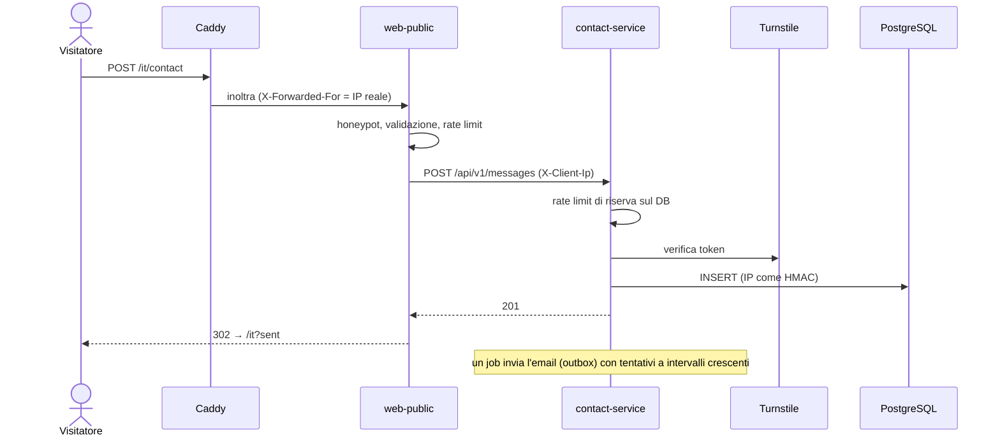

# Architettura di sito-j

Sito personale bilingue (IT/EN) costruito come piccolo sistema a microservizi.
Java 25 · Spring Boot 4.1 · PostgreSQL 18 · Docker Compose · Caddy · GitHub Actions.

---

## 1. Panoramica

```
Internet ──▶ Caddy ──────────▶ web-public ──┬──▶ profile-service  ──┐
            HTTPS, CSP,         (porta 8080) ├──▶ projects-service ──┼──▶ PostgreSQL
            body ≤ 64 KB,                    └──▶ contact-service  ──┘    (uno schema e un
            /api e /actuator bloccati                 │                    utente per servizio)
                                                      ├──▶ Cloudflare Turnstile (anti-bot)
                       projects-service ──▶ GitHub/GitLab API (statistiche repository)
                                                      └──▶ SMTP (email di notifica)
```

| Modulo | Porta | Responsabilità | Raggiungibile da Internet |
|---|---|---|---|
| `web-public` | 8080 | Pagine HTML (Thymeleaf), SEO, form contatti | Solo tramite Caddy |
| `profile-service` | 8081 | Profilo, esperienze, formazione, skill, link | No |
| `projects-service` | 8082 | Progetti, tag, sincronizzazione dei repository | No |
| `contact-service` | 8083 | Messaggi del form, anti-bot, notifica email, retention | No |

**Scelte deliberate**
- **Niente service discovery né config server.** In Docker Compose i servizi si trovano per nome (`http://profile-service:8081`), la configurazione arriva da variabili d'ambiente.
- **Niente gateway Java.** Spring Cloud Gateway per Boot 4.1 è disponibile solo in release candidate. I suoi compiti (unico ingresso, blocco delle API interne, limite del body, header di sicurezza) li svolge Caddy, il rate limit del form lo fa web-public (§6). Un gateway si potrà inserire tra Caddy e web-public senza toccare gli altri servizi.
- **Niente DTO condivisi.** Ogni consumatore definisce i propri `record`: un po' di duplicazione, in cambio di servizi indipendenti.

---

## 2. Organizzazione del codice

Maven multi-modulo, package base `dev.jj`, **package per funzionalità** (non per layer).

Nei tre servizi REST:
```
Controller (@RestController, DTO record, Bean Validation)
   └─▶ Service (@Transactional, mapping Entity → DTO)
         └─▶ Repository (Spring Data JPA)
               └─▶ Entity (mai fuori dal service)
```
- Schema del database **solo via Flyway** (`db/migration`); Hibernate in `ddl-auto: validate`.
- I dati reali del profilo e dei progetti sono migrazioni separate in `db/seed`, escluse nei test.
- Errori come **ProblemDetail** (RFC 9457).
- Test di integrazione con **Testcontainers** (PostgreSQL vero) e MockMvc.

In web-public: MVC classico. I client HTTP (`ServiceClients`, `ContactClient`) chiamano i servizi, `SiteService` costruisce un view-model già pronto (`HomeView`), i template Thymeleaf lo mostrano senza logica.

---

## 3. Database

Una sola istanza PostgreSQL, **uno schema e un utente per servizio**, ciascuno con permessi solo sul proprio schema (creati da `docker/postgres/init/01-schemas-and-users.sh`).

**Traduzioni:** ogni entità con testi traducibili ha una tabella `*_translation` con chiave `(id, lang)`, `lang` = `it` | `en`. Se manca la lingua richiesta si usa `en`.

### Schema `profile`
| Tabella | Contenuto |
|---|---|
| `profile` (+ `_translation`) | Una sola riga: nome, email pubblica, città, avatar; per lingua headline, bio, link al CV |
| `social_link` | GitHub, GitLab, LinkedIn… con ordinamento |
| `experience` (+ `_translation`) | Azienda e date; per lingua ruolo e descrizione |
| `education` (+ `_translation`) | Istituto e date; per lingua titolo e descrizione |
| `skill_category` (+ `_translation`), `skill` | Categorie (BACKEND, CLOUD, OTHER) e skill |

### Schema `projects`
| Tabella | Contenuto |
|---|---|
| `project` (+ `_translation`) | Slug, stato (`DRAFT`/`PUBLISHED`/`ARCHIVED`), in evidenza, repository (`GITHUB`/`GITLAB`/`NONE`); per lingua titolo, riassunto, contesto, testo |
| `tag`, `project_tag` | Tag dei progetti |
| `repo_stats` | Stelle, fork, linguaggi, ultimo commit: scritta solo dal job di sincronizzazione |

### Schema `contact`
| Tabella | Contenuto |
|---|---|
| `contact_message` | Nome, email, oggetto, testo, lingua, **hash HMAC dell'IP** (mai l'IP in chiaro), stato, data di notifica, tentativi di invio |

---

## 4. API REST (solo rete interna)

| Servizio | Endpoint | Descrizione |
|---|---|---|
| profile | `GET /api/v1/profile?lang=it\|en` | Profilo completo in una chiamata: dati, link, esperienze, formazione, skill |
| projects | `GET /api/v1/projects?lang=&tag=&featured=` | Progetti pubblicati, con tag e repository |
| projects | `GET /api/v1/projects/{slug}?lang=` | Dettaglio di un progetto |
| projects | `GET /api/v1/tags` | Tag in uso |
| contact | `POST /api/v1/messages` | Nuovo messaggio (con token Turnstile) → `201` |

Le pagine di web-public:

| URL | Pagina |
|---|---|
| `/` | Redirect a `/it` o `/en` in base alla lingua del browser |
| `/{lang}` | Home: presentazione, numeri, progetti, skill, percorso, contatti |
| `POST /{lang}/contact` | Invio del form (Post/Redirect/Get) |
| `/{lang}/privacy` | Informativa privacy |
| `/sitemap.xml`, `/robots.txt` | SEO |

---

## 5. Flussi principali

**Apertura della home.** web-public chiede profilo e progetti ai servizi. Le risposte restano in cache 5 minuti (`StaleCache`); se un servizio è giù si usa l'ultimo dato buono, oppure la sezione resta vuota con un avviso: mai una pagina di errore.

**Invio del form contatti**


**Job pianificati**
- `projects-service`: sincronizza le statistiche dei repository 1 minuto dopo l'avvio e poi ogni 6 ore.
- `contact-service`: invia le notifiche in sospeso ogni minuto (fino a 12 tentativi); ogni notte alle 3:30 cancella i messaggi più vecchi di 365 giorni.

---

## 6. Sicurezza

| Livello | Misura |
|---|---|
| Rete | Solo Caddy pubblica porte (80/443). Servizi Java e PostgreSQL restano nella rete Docker interna. |
| Caddy | HTTPS automatico, HSTS, CSP senza script inline, `X-Frame-Options`, `nosniff`; `/api/*` e `/actuator/*` rispondono 404; body massimo 64 KB. |
| IP del visitatore | Caddy sostituisce `X-Forwarded-For` con l'IP reale. web-public lo accetta solo da proxy interni (`forward-headers-strategy: native`) e costruisce da sé `X-Client-Ip` verso contact-service: quello inviato dal browser non passa mai. |
| Form | Rate limit rigido in web-public (5 invii/ora per IP, 50/ora in totale, massimo 10.000 IP in memoria, poi rifiuta), honeypot, Turnstile fail-closed, Post/Redirect/Get. Rate limit di riserva in contact-service. |
| Output | Tutto il testo dai servizi è escapato; i link passano da `safeUrl` (solo http(s), mailto e percorsi interni); il JSON-LD non può chiudere il tag `<script>`. |
| Configurazione | Segreti obbligatori validati all'avvio (`ContactProperties`): con valori mancanti o d'esempio il servizio non parte. Segreti solo in `.env`, mai su Git. Ogni container riceve solo le proprie variabili. |
| Privacy (GDPR) | IP salvato solo come HMAC-SHA256 con chiave segreta; messaggi cancellati dopo 12 mesi; informativa IT/EN. |
| Chiamate esterne | Timeout su ogni chiamata: HTTP (connect 2-5 s, read 5-15 s) e SMTP (10 s). |
| Container | Immagine JRE Alpine, utente non root, solo il jar dentro (`.dockerignore`). |

**Presupposto per il deploy:** web-public non deve mai essere raggiungibile direttamente da Internet, altrimenti un client potrebbe falsificare `X-Forwarded-For`.

---

## 7. Infrastruttura

- **Locale:** `docker compose up -d --build` avvia tutto lo stack, raggiungibile su http://localhost:8088.
- **CI (GitHub Actions):** a ogni push build e test; su `main` le immagini vengono pubblicate su GHCR per amd64 e arm64.
- **Produzione completa (pronta, non attiva):** VM Oracle Cloud Always Free + `docker-compose.prod.yml` + dominio. Procedura in [DEPLOY.md](DEPLOY.md).
- **Online oggi:** una **copia statica** del sito su GitHub Pages, generata dal sito vero in modalità statica, senza il form. Script: `scripts/export-static.sh` e `scripts/publish-pages.sh`.

---

## 8. Possibili evoluzioni

- Deploy dello stack completo su Oracle Cloud, con form attivo e dominio is-a.dev.
- Pannello di amministrazione (Vaadin) con API `/api/v1/admin/**` protette, per modificare i contenuti senza migrazioni.
- Pagina di dettaglio dei progetti (`/{lang}/projects/{slug}`, l'API esiste già).
- Metriche (Prometheus/Grafana) e backup automatici del database.
