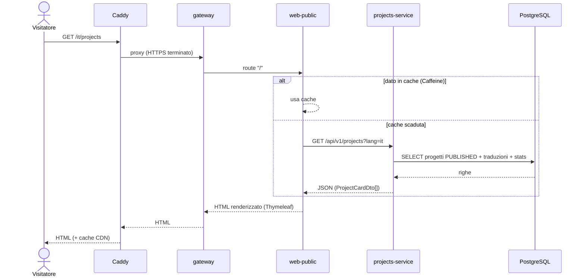
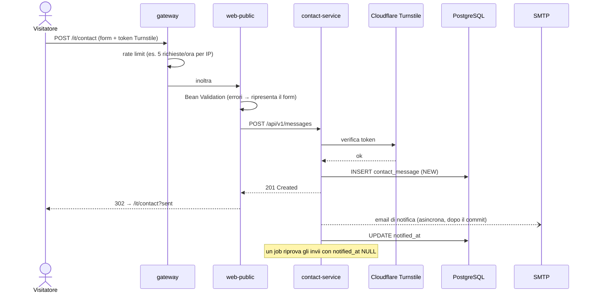
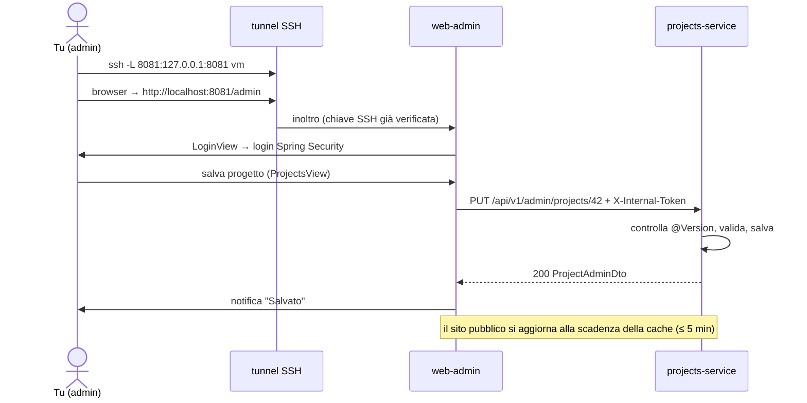
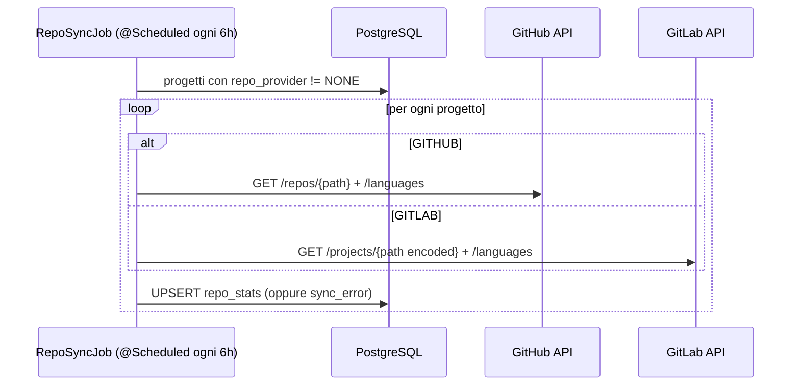

# Sito personale — Documento di architettura

> Versione 1 · 2026-11-02 · Stack: Java 25 (LTS), Spring Boot 4.x, Spring Cloud (release train compatibile), Thymeleaf, Vaadin, PostgreSQL, Docker Compose

---

## 1. Obiettivi

| Obiettivo | Come lo raggiungiamo |
|---|---|
| Farsi trovare su Google cercando il proprio nome | Pagine pubbliche renderizzate lato server (Thymeleaf), URL per lingua, `hreflang`, sitemap, Open Graph, JSON-LD `Person` |
| Bel profilo linkato da LinkedIn | Anteprima Open Graph curata (titolo, foto, descrizione) |
| Contenuti aggiornabili senza redeploy | Pannello admin in Vaadin |
| Progetti sempre aggiornati | Sincronizzazione automatica con GitHub/GitLab |
| Bilingue IT / EN | i18n dei testi UI + traduzioni dei contenuti nel DB |
| Allenarsi su Spring Boot e microservizi | 6 servizi con responsabilità chiare, Docker, CI/CD |
| Costo 0 € | VM ARM Oracle Cloud Always Free + sottodominio gratuito (`tuonome.is-a.dev`) + HTTPS Let's Encrypt via Caddy |

---

## 2. I microservizi: sono 6

> **Decisione (nov 2026):** per ora **niente gateway Java**. Spring Cloud Gateway per Boot 4.1 esiste solo in release candidate; i suoi compiti (unico ingresso, blocco di `/api` e `/actuator`, limite del body, header di sicurezza) li fa **Caddy**, il rate limit lo fa web-public (§8.1). Il gateway si potrà inserire più avanti tra Caddy e web-public senza toccare gli altri servizi.

```
                         Internet
                            │
                            │  https://tuonome.is-a.dev  (porte 80/443)
                     ┌──────▼──────┐
                     │    Caddy    │  reverse proxy · HTTPS automatico (Let's Encrypt)
                     └──────┬──────┘
                     ┌──────▼──────┐
                     │ 1. gateway  │  Spring Cloud Gateway
                     └──┬───────┬──┘
              /  /it  /en       ┆ /admin → SOLO via tunnel SSH, mai pubblico
           ┌────────▼───┐   ┌───▼──────────┐
           │2.web-public│   │ 3. web-admin │
           │ MVC+Thymel.│   │    Vaadin    │
           └─────┬──────┘   └──────┬───────┘
                 │  REST interno   │  (rete Docker privata)
     ┌───────────┼─────────────────┼────────────┐
     ▼           ▼                 ▼            ▼
┌──────────┐ ┌──────────┐    ┌──────────┐
│4.profile │ │5.projects│    │6.contact │
│ -service │ │ -service │    │ -service │
└────┬─────┘ └────┬─────┘    └────┬─────┘
     │            │ ↕ GitHub/GitLab API │ → SMTP (email)
     └────────────┼──────────────────┘
          ┌───────▼────────┐
          │   PostgreSQL   │  schemi: profile · projects · contact
          └────────────────┘
```

| # | Servizio | Tipo | Responsabilità | Esposto all'esterno? |
|---|---|---|---|---|
| 1 | `gateway` | Spring Cloud Gateway | Unico ingresso, routing, rate limiting, header di sicurezza | **Sì** (dietro Caddy) |
| 2 | `web-public` | Spring MVC + Thymeleaf | Sito pubblico, SEO, i18n, form contatti | Tramite gateway |
| 3 | `web-admin` | Vaadin + Spring Security | Pannello per gestire contenuti e leggere messaggi | **No**: solo `127.0.0.1` sulla VM, ci accedi con tunnel SSH |
| 4 | `profile-service` | REST + JPA | Bio, esperienze, formazione, skill, link social | No (solo rete interna) |
| 5 | `projects-service` | REST + JPA + scheduler | Progetti, tag, sincronizzazione repository | No |
| 6 | `contact-service` | REST + JPA + mail | Messaggi dal form, anti-spam, notifica email | No |

**Scelte deliberate (per non complicare inutilmente):**
- Niente Eureka/Consul: in Docker Compose i servizi si trovano già per nome DNS (`http://profile-service:8080`).
- Niente Config Server: la configurazione arriva da variabili d'ambiente (file `.env`, non committato).
- Niente servizio di autenticazione separato: c'è un solo utente (tu), gestito da `web-admin`.
- Le API REST **non** sono pubbliche: le chiamano solo i due frontend dalla rete Docker interna.

---

## 3. Database (PostgreSQL)

Un'istanza, **uno schema per servizio**, **un utente DB per servizio**, ognuno con permessi solo sul proprio schema. Così i servizi restano indipendenti: nessuno legge le tabelle degli altri. Ogni servizio gestisce le proprie migrazioni con **Flyway**.

### Convenzione per le traduzioni
Per ogni entità con testi traducibili c'è una tabella `*_translation` con chiave `(id_entità, lang)`, dove `lang` vale `'it'` o `'en'`.
Se manca la traduzione richiesta si mostra quella in `en` (fallback).

### 3.1 Schema `profile`

```
profile                         (una sola riga)
├─ id                 BIGINT PK
├─ full_name          VARCHAR(100)
├─ public_email       VARCHAR(255)
├─ location           VARCHAR(100)
├─ avatar_url         VARCHAR(500)
├─ updated_at         TIMESTAMPTZ

profile_translation
├─ profile_id         FK → profile   ┐ PK
├─ lang               CHAR(2)        ┘
├─ headline           VARCHAR(200)   es. "Junior Java Developer"
├─ bio_md             TEXT           (markdown)
├─ cv_url             VARCHAR(500)   CV nella lingua

social_link
├─ id                 BIGINT PK
├─ type               VARCHAR(20)    GITHUB | GITLAB | LINKEDIN | EMAIL | WEBSITE | OTHER
├─ url                VARCHAR(500)
├─ label              VARCHAR(100)
├─ sort_order         INT

experience
├─ id                 BIGINT PK
├─ company            VARCHAR(150)
├─ company_url        VARCHAR(500) NULL
├─ location           VARCHAR(100)
├─ start_date         DATE
├─ end_date           DATE NULL      (NULL = in corso)
├─ sort_order         INT

experience_translation
├─ experience_id      FK ┐ PK
├─ lang               ───┘
├─ role               VARCHAR(150)
├─ description_md     TEXT

education                         (stessa struttura di experience)
├─ id, institution, start_date, end_date, sort_order
education_translation
├─ education_id, lang, degree, description_md

skill_category
├─ id                 BIGINT PK
├─ code               VARCHAR(50) UNIQUE   es. BACKEND, DATABASE, DEVOPS
├─ sort_order         INT
skill_category_translation
├─ category_id, lang, name                 es. "Backend" / "Backend"

skill
├─ id                 BIGINT PK
├─ category_id        FK → skill_category
├─ name               VARCHAR(80)    es. "Spring Boot" (non si traduce)
├─ level              SMALLINT NULL  1..5 (facoltativo)
├─ sort_order         INT
```

### 3.2 Schema `projects`

```
project
├─ id                 BIGINT PK
├─ slug               VARCHAR(100) UNIQUE   es. "gestionale-magazzino" → usato nell'URL
├─ status             VARCHAR(20)    DRAFT | PUBLISHED | ARCHIVED
├─ featured           BOOLEAN        in evidenza in home
├─ start_date         DATE NULL
├─ end_date           DATE NULL
├─ repo_provider      VARCHAR(10)    GITHUB | GITLAB | NONE
├─ repo_path          VARCHAR(200)   es. "mario/gestionale" (owner/nome)
├─ demo_url           VARCHAR(500) NULL
├─ cover_image_url    VARCHAR(500) NULL
├─ sort_order         INT
├─ created_at         TIMESTAMPTZ
├─ updated_at         TIMESTAMPTZ
├─ version            INT            (optimistic locking JPA @Version)

project_translation
├─ project_id         FK ┐ PK
├─ lang               ───┘
├─ title              VARCHAR(150)
├─ summary            VARCHAR(300)   (riga nella card + meta description)
├─ body_md            TEXT           (pagina di dettaglio: problema, soluzione, cosa ho fatto io)

tag
├─ id                 BIGINT PK
├─ name               VARCHAR(50)    es. "Spring Boot"
├─ slug               VARCHAR(50) UNIQUE

project_tag
├─ project_id         FK ┐ PK
├─ tag_id             FK ┘

repo_stats                         (scritta solo dal job di sincronizzazione)
├─ project_id         FK PK
├─ stars              INT
├─ forks              INT
├─ primary_language   VARCHAR(50)
├─ languages          JSONB          es. {"Java": 81.2, "HTML": 18.8}
├─ last_commit_at     TIMESTAMPTZ
├─ synced_at          TIMESTAMPTZ
├─ sync_error         VARCHAR(500) NULL
```

### 3.3 Schema `contact`

```
contact_message
├─ id                 UUID PK
├─ name               VARCHAR(100)
├─ email              VARCHAR(255)
├─ subject            VARCHAR(150)
├─ body               TEXT           (max 5000 caratteri)
├─ lang               CHAR(2)
├─ ip_hash            VARCHAR(64)    SHA-256 dell'IP + salt (privacy/GDPR: non salviamo l'IP in chiaro)
├─ status             VARCHAR(20)    NEW | READ | ARCHIVED | SPAM
├─ notified_at        TIMESTAMPTZ NULL   (NULL = email di notifica non ancora inviata → retry)
├─ created_at         TIMESTAMPTZ
```

> L'utente admin **non** sta nel DB: username e hash bcrypt della password arrivano da variabili d'ambiente di `web-admin`.

---

## 4. API REST

Convenzioni:
- Prefisso `/api/v1/...`; le API di scrittura stanno sotto `/api/v1/admin/...`
- La lingua si passa con `?lang=it|en` (esplicito e facile da mettere in cache)
- Gli errori seguono lo standard **ProblemDetail (RFC 9457)**
- Paginazione con `?page=&size=` (Spring `Pageable`)
- Documentazione automatica con **springdoc-openapi** (Swagger UI attiva solo in sviluppo)
- Le API `/admin/**` richiedono l'header `X-Internal-Token` (segreto condiviso, dal `.env`)

### 4.1 profile-service

| Metodo | Path | Chi la usa | Descrizione |
|---|---|---|---|
| GET | `/api/v1/profile?lang=` | web-public | Profilo **aggregato**: dati, bio, link, esperienze, formazione, skill (1 chiamata = pagina About) |
| GET | `/api/v1/admin/profile` | web-admin | Profilo con **tutte** le traduzioni |
| PUT | `/api/v1/admin/profile` | web-admin | Aggiorna profilo + traduzioni |
| GET/POST | `/api/v1/admin/experiences` | web-admin | Lista / crea |
| PUT/DELETE | `/api/v1/admin/experiences/{id}` | web-admin | Modifica / elimina |
| GET/POST, PUT/DELETE | `/api/v1/admin/educations[/{id}]` | web-admin | idem |
| GET/POST, PUT/DELETE | `/api/v1/admin/skills[/{id}]`, `/admin/skill-categories[/{id}]` | web-admin | idem |
| GET/POST, PUT/DELETE | `/api/v1/admin/links[/{id}]` | web-admin | idem |
| PUT | `/api/v1/admin/{risorsa}/order` | web-admin | Riordino (lista di id) per drag & drop |

### 4.2 projects-service

| Metodo | Path | Chi la usa | Descrizione |
|---|---|---|---|
| GET | `/api/v1/projects?lang=&tag=&featured=` | web-public | Lista card (solo `PUBLISHED`) con stats repo |
| GET | `/api/v1/projects/{slug}?lang=` | web-public | Dettaglio progetto |
| GET | `/api/v1/tags` | web-public | Tag usati (per i filtri) |
| GET | `/api/v1/admin/projects?status=&page=` | web-admin | Lista completa |
| GET | `/api/v1/admin/projects/{id}` | web-admin | Progetto con tutte le traduzioni |
| POST | `/api/v1/admin/projects` | web-admin | Crea (nasce `DRAFT`) |
| PUT | `/api/v1/admin/projects/{id}` | web-admin | Modifica (con `version` per optimistic locking) |
| PATCH | `/api/v1/admin/projects/{id}/status` | web-admin | Pubblica / archivia |
| DELETE | `/api/v1/admin/projects/{id}` | web-admin | Elimina |
| POST | `/api/v1/admin/projects/{id}/sync` | web-admin | Forza la sincronizzazione del repository |
| CRUD | `/api/v1/admin/tags[/{id}]` | web-admin | Gestione tag |

### 4.3 contact-service

| Metodo | Path | Chi la usa | Descrizione |
|---|---|---|---|
| POST | `/api/v1/messages` | web-public | Nuovo messaggio (con token Turnstile anti-bot) → `201` |
| GET | `/api/v1/admin/messages?status=&page=` | web-admin | Inbox |
| GET | `/api/v1/admin/messages/{id}` | web-admin | Dettaglio |
| PATCH | `/api/v1/admin/messages/{id}/status` | web-admin | Letto / archiviato / spam |
| DELETE | `/api/v1/admin/messages/{id}` | web-admin | Elimina |
| GET | `/api/v1/admin/messages/stats` | web-admin | Conteggi per la dashboard |

### Esempio di risposta: `GET /api/v1/projects?lang=it&featured=true`
```json
[
  {
    "slug": "gestionale-magazzino",
    "title": "Gestionale magazzino",
    "summary": "Applicazione Spring Boot per la gestione delle giacenze…",
    "coverImageUrl": "https://…/cover.webp",
    "tags": [{ "name": "Spring Boot", "slug": "spring-boot" }],
    "repo": {
      "provider": "GITHUB",
      "url": "https://github.com/mario/gestionale",
      "stars": 12,
      "primaryLanguage": "Java",
      "lastCommitAt": "2026-10-20T14:00:00Z"
    },
    "demoUrl": null
  }
]
```

---

## 5. Frontend

### 5.1 web-public (Spring MVC + Thymeleaf), il sito che vede il mondo

| URL | Pagina | Dati da |
|---|---|---|
| `/` | Redirect a `/it` o `/en` in base all'`Accept-Language` del browser | — |
| `/{lang}` | Home: presentazione, progetti in evidenza, skill principali, CTA contatti | profile + projects(featured) |
| `/{lang}/about` | Bio, esperienze (timeline), formazione, skill, download CV | profile |
| `/{lang}/projects` | Griglia progetti con filtro per tag | projects + tags |
| `/{lang}/projects/{slug}` | Dettaglio progetto (markdown → HTML), link repo e demo, stats | projects |
| `/{lang}/contact` | Form contatti (GET mostra, POST invia) | contact |
| `/sitemap.xml`, `/robots.txt` | Per Google | projects |

**SEO in ogni pagina:** `<title>` e `meta description` specifici, `<link rel="alternate" hreflang="it|en">`, canonical, Open Graph e Twitter card (anteprima su LinkedIn), JSON-LD `Person` in home.
**Resilienza:** risposte dei servizi in cache con Caffeine (TTL ~5 min). Se un servizio è giù si mostra l'ultimo dato in cache o una sezione vuota "elegante", mai una pagina di errore intera.
**Stile:** HTML semantico + CSS proprio (o Pico/Tailwind via CDN), tema chiaro/scuro, mobile-first. Niente framework JS: un pizzico di JS solo dove serve.

> **Aggiornamento (nov 2026):** la home è un'unica pagina con sezioni (progetti, skill, percorso, contatti), come nel prototipo; `/{lang}/about` e `/{lang}/projects` non esistono come pagine separate. Implementati: `/`, `/{lang}`, `/robots.txt`, `/sitemap.xml`. Il dettaglio progetto e il form contatti arrivano dopo (il form richiede il gateway, vedi §8.1). I testi del sito stanno in `messages_*.properties`; i dati personali arrivano dai servizi, con cache e ultimo dato buono se un servizio è giù.

### 5.2 web-admin (Vaadin), il pannello di controllo

| Vista | Contenuto |
|---|---|
| `LoginView` | Login Vaadin + Spring Security |
| `DashboardView` | Messaggi nuovi, numero di progetti per stato, esito ultima sincronizzazione repo |
| `ProfileView` | Form dati anagrafici + tab IT / EN per headline, bio e CV |
| `ExperienceView`, `EducationView` | Grid + form laterale (pattern master-detail), tab IT/EN |
| `SkillsView` | Categorie e skill, riordino |
| `ProjectsView` | Grid con filtro per stato → editor: dati, tag (MultiSelectComboBox), repo, tab IT/EN con editor markdown e anteprima, bottoni Pubblica e Sincronizza |
| `MessagesView` | Inbox: grid, dettaglio, segna come letto/archiviato/spam |
| `MainLayout` | AppLayout con menu laterale |

---

## 6. Il modello MVC e i layer

### 6.1 Nei microservizi di backend (4, 5, 6): architettura a layer

```
HTTP JSON
   │
┌──▼─────────────────────┐
│ Controller (@RestController) │  riceve/valida i DTO (Bean Validation), nessuna logica
└──┬─────────────────────┘
   │ DTO (Java record)
┌──▼─────────────────────┐
│ Service (@Service)     │  logica di business, @Transactional, mapping Entity↔DTO
└──┬─────────────────────┘
   │ Entity
┌──▼─────────────────────┐
│ Repository (Spring Data JPA) │  accesso al DB
└──┬─────────────────────┘
   ▼
PostgreSQL
```

Regole:
- **Le Entity JPA non escono mai dal service**: i controller parlano solo con DTO (`record`).
- Mapping con **MapStruct** (oppure a mano se semplice).
- Un `@RestControllerAdvice` globale converte le eccezioni in `ProblemDetail`.
- **Package per funzionalità**, non per layer:

```
dev.<nome>.projects
├── ProjectsServiceApplication.java
├── project/
│   ├── ProjectController.java          (pubblico)
│   ├── AdminProjectController.java     (admin)
│   ├── ProjectService.java
│   ├── ProjectRepository.java
│   ├── Project.java                    (entity)
│   ├── ProjectTranslation.java         (entity)
│   ├── ProjectStatus.java              (enum)
│   ├── ProjectMapper.java              (MapStruct)
│   └── dto/  ProjectCardDto, ProjectDetailDto, ProjectAdminDto, ProjectUpsertRequest …
├── tag/
├── sync/
│   ├── RepoClient.java                 (interfaccia)
│   ├── GitHubClient.java, GitLabClient.java
│   └── RepoSyncJob.java                (@Scheduled)
└── common/
    ├── GlobalExceptionHandler.java
    └── security/InternalTokenFilter.java
```

### 6.2 In web-public: MVC "classico"

- **Model:** i view-model costruiti con i dati ottenuti dai servizi tramite client HTTP dichiarativi (`@HttpExchange`, ad esempio `ProjectsClient`)
- **View:** template Thymeleaf (`templates/projects/list.html`) con layout comune (header, footer, meta SEO)
- **Controller:** `@Controller` che chiama i client, mette i dati nel `Model` e restituisce il nome della view

```java
@Controller
@RequestMapping("/{lang:it|en}/projects")
class ProjectPageController {
    private final ProjectsClient projects;

    @GetMapping
    String list(@PathVariable String lang, @RequestParam(required = false) String tag, Model model) {
        model.addAttribute("projects", projects.list(lang, tag, null));
        model.addAttribute("tags", projects.tags());
        return "projects/list";
    }
}
```

Per il form contatti si usa il pattern **Post/Redirect/Get**: POST → validazione → redirect a `/{lang}/contact?sent`. Così il refresh non reinvia il form.

### 6.3 In web-admin: Vaadin (MVP-like)

Le **View** Vaadin (componenti Java) usano dei **service lato client** (`AdminProjectsClient`…) che chiamano le API admin. Il binding dei form è fatto da `Binder<T>` sui DTO, con validazione.

### 6.4 DTO condivisi?

No, niente modulo comune con i DTO. Ogni frontend definisce i propri `record` per ciò che consuma. È un po' di duplicazione, ma i servizi restano indipendenti (si può cambiare un servizio senza ricompilare gli altri). Il contratto è documentato da OpenAPI.

---

## 7. Flussi principali

### 7.1 Visitatore apre la lista progetti


### 7.2 Invio del form contatti


### 7.3 Modifica di un progetto dal pannello admin


### 7.4 Sincronizzazione dei repository


---

## 8. Sicurezza

| Livello | Misura |
|---|---|
| Rete | Porte aperte sulla VM: 80/443 (Caddy) e 22 (SSH solo con chiave, fail2ban). I servizi non pubblicano porte in compose; `web-admin` è pubblicato solo su `127.0.0.1`. |
| Gateway | Instrada solo `/`, `/it/**`, `/en/**` e le risorse statiche. `/api/**` e `/admin/**` non sono raggiungibili da fuori. Rate limit sul POST del form contatti. |
| Admin | Raggiungibile solo con tunnel SSH + login Spring Security (password bcrypt da variabile d'ambiente) |
| Servizi | `InternalTokenFilter` su `/api/v1/admin/**` (difesa in profondità) |
| DB | Un utente per servizio, permessi solo sul proprio schema; backup `pg_dump` giornaliero |
| Segreti | File `.env` (non committato) + `.env.example` committato |
| Header | CSP, HSTS (impostati da Caddy), X-Content-Type-Options, Referrer-Policy |
| Privacy | IP salvato solo come HMAC-SHA256 con chiave segreta (`CONTACT_IP_SALT`, obbligatoria: senza il servizio non parte); messaggi cancellati dopo 365 giorni (job notturno); pagina privacy (IT/EN) che lo dichiara |
| Form contatti | Turnstile fail-closed; rate limit di difesa nel servizio (5/ora per IP, 50/ora in totale → 429) prima di chiamare Cloudflare; header email ripuliti dagli a-capo |
| Chiamate esterne | Timeout su SMTP (10 s) e HTTP (connect 5 s, read 10-15 s): un servizio esterno bloccato non deve bloccare i job |

### 8.1 Obblighi per gateway e web-public (contratto di sicurezza)

Questi punti sono **presupposti** dai servizi interni. Vanno implementati e testati quando costruiremo gateway e web-public:

1. **`X-Client-Ip` va SOVRASCRITTO** con l'IP reale del visitatore, preso dall'header affidabile impostato da Caddy, e mai inoltrato così come arriva dal client. contact-service lo usa per il rate limit e per l'hash, e scarta i valori che non sembrano un IP.
2. **Rate limit rigido sul POST del form** nel gateway (quello in contact-service è solo una difesa in profondità e può essere superato di poco con richieste simultanee).
3. **Limite di dimensione del body** (es. 64 KB) nel gateway: contact-service valida i campi dopo il parsing del JSON.
4. **Le API `/api/**` non sono instradate verso l'esterno.**

**Stato (nov 2026), form contatti in web-public:**

| Obbligo | Dove è implementato |
|---|---|
| 1. IP reale | Caddy sostituisce `X-Forwarded-For` con l'IP del client (non si fida degli header in arrivo). In web-public `server.forward-headers-strategy: native`: Tomcat usa `X-Forwarded-For` **solo** se la richiesta arriva da un proxy interno (reti private, localhost). web-public costruisce da sé `X-Client-Ip` verso contact-service: quello inviato dal browser non viene mai inoltrato (test `lIpMandatoDalBrowserNonArrivaMaiAlServizio`). |
| 2. Rate limit rigido | `FormRateLimiter` in web-public: 5 invii/ora per IP e 50/ora in totale, `synchronized` (nessun superamento con richieste simultanee), massimo 10.000 IP in memoria, poi rifiuta (fail-closed). Si conta solo dopo validazione e token presente. |
| 3. Limite body | `server.tomcat.max-http-form-post-size: 64KB` in web-public (verificato: 100 KB → 413). In produzione anche `request_body max_size` in Caddy. |
| 4. `/api/**` non esposte | I servizi non pubblicano porte; Caddy instrada solo verso web-public. |

Altre difese del form: honeypot (campo trappola, risposta identica a un successo), Turnstile fail-closed, script di Cloudflare caricato solo vicino al form, Post/Redirect/Get, pagina privacy IT/EN.
**Presupposto da rispettare nel deploy:** web-public non deve mai essere raggiungibile direttamente da Internet, altrimenti un client potrebbe falsificare `X-Forwarded-For`.
**CSP (da impostare in Caddy):** `script-src 'self' 'unsafe-inline' https://challenges.cloudflare.com; frame-src https://challenges.cloudflare.com` (l'inline serve allo script del tema e al JSON-LD).

---

## 9. Infrastruttura e deploy

- **Locale:** `docker compose up` avvia Postgres + tutti i servizi. Durante lo sviluppo si può avviare solo Postgres e lanciare il servizio dall'IDE.
- **Produzione:** VM ARM Oracle Cloud Free Tier, stesso compose + `docker-compose.prod.yml` (override).
- **Immagini:** costruite con Spring Boot Buildpacks oppure con un Dockerfile multi-stage, **multi-architettura (amd64 + arm64)**.
- **CI/CD (GitHub Actions):** build + test (Testcontainers) → push immagini su GHCR → deploy via SSH (`docker compose pull && up -d`).
- **Osservabilità:** Actuator (`/actuator/health` per gli healthcheck di compose); più avanti Prometheus + Grafana.
- **Memoria stimata:** 6 JVM da circa 300-400 MB + Postgres ≈ 3 GB, ampiamente dentro i 24 GB della VM gratuita.

---

### 9.1 Hosting a costo zero: cosa usiamo

| Pezzo | Servizio gratuito | Note |
|---|---|---|
| Server | **Oracle Cloud Always Free**, VM `VM.Standard.A1.Flex` (ARM) | Fino a 4 OCPU e 24 GB in totale. Creiamo la VM con **2 OCPU / 12 GB**: con circa 3 GB occupati la RAM resta sopra la soglia del 20% e Oracle non considera la VM "inattiva" (le VM inattive possono essere recuperate). Serve una carta di credito solo per la verifica dell'identità: **non** passare all'account Pay As You Go. |
| Regione | Scelta una volta sola alla registrazione | Se Milano o Francoforte danno "out of capacity" per le VM ARM, si riprova più tardi o si sceglie un'altra regione UE. |
| Dominio | **is-a.dev** → `tuonome.is-a.dev` | Gratuito per sviluppatori: si richiede con una Pull Request su GitHub, con un record A verso l'IP della VM. Alternative: `eu.org` (gratis, ma l'approvazione può richiedere settimane) e DuckDNS (meno professionale). |
| HTTPS | **Caddy** + Let's Encrypt | Certificati automatici e rinnovo automatico |
| Anti-bot | **Cloudflare Turnstile** | Gratuito, non richiede che il dominio sia su Cloudflare |
| Email di notifica | **SMTP di Gmail** con "password per le app" | Gratuito, i volumi sono minimi |
| Immagini Docker | **GHCR** | Gratuito per i repository pubblici |
| CI/CD | **GitHub Actions** | Gratuito per i repository pubblici; runner ARM disponibili |
| Backup | `pg_dump` giornaliero → **Object Storage Oracle** (20 GB Always Free) | |

> Se un giorno vorrai un dominio tutto tuo (circa 10-15 €/anno), basta cambiare il record DNS e la riga di Caddy: nient'altro.

## 10. Struttura del repository

```
sito-j/
├── pom.xml                    parent: Java 25, BOM di Spring Boot / Spring Cloud / Vaadin
├── gateway/
├── web-public/
├── web-admin/
├── profile-service/
├── projects-service/
├── contact-service/
├── docker/
│   └── postgres/init.sql      crea schemi e utenti
├── docker-compose.yml
├── docker-compose.prod.yml
├── .env.example
├── docs/ARCHITETTURA.md
└── .github/workflows/ci.yml
```

---

## 11. Roadmap (in ordine)

1. **Scheletro:** parent pom, `docker-compose` con Postgres, `profile-service` con Flyway, entity, API pubbliche e test.
2. **projects-service:** CRUD, tag, job di sincronizzazione GitHub/GitLab.
3. **web-public:** layout, i18n, pagine Home/About/Projects, SEO, cache.
4. **contact-service** + pagina contatti + email + Turnstile.
5. **web-admin** (Vaadin): login, dashboard, editor.
6. **gateway** + rete Docker definitiva.
7. **CI/CD** + VM Oracle + sottodominio is-a.dev + Caddy → **online**.
8. Rifiniture: Lighthouse ≥ 95, accessibilità, Prometheus/Grafana, backup automatici.
